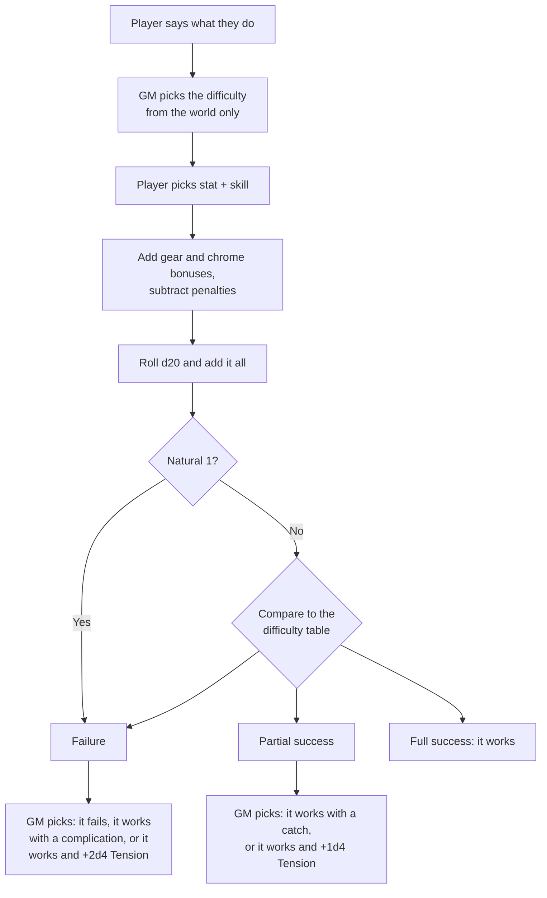
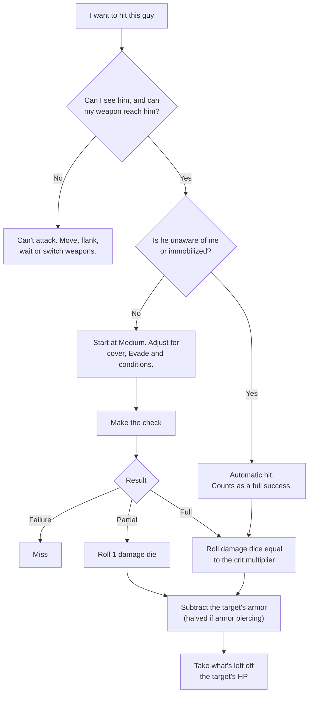
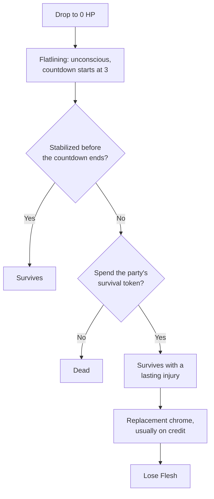

# Core Rules

## Making a check

**Roll d20 + stat + skill + modifiers** and compare the total to the table.

- **The GM sets the difficulty from the world:** the guard, the lock, the weather, the target's cover. Never from the character sheet.
- **The player adds everything about the character:** stat, skill, gear and chrome bonuses, and penalties (the wrong tool, a weapon outside its effective range).
- **A natural 1 always fails.**
- **The GM decides what the result means** (see Outcomes and Tension).

| Difficulty      | Failure    | Partial success | Full success |
| --------------- | ---------- | --------------- | ------------ |
| Easy            | 5 or less  | 6–15            | 16+          |
| Medium          | 10 or less | 11–20           | 21+          |
| Hard            | 15 or less | 16–25           | 26+          |
| Very Hard       | 20 or less | 21–30           | 31+          |
| Nigh Impossible | 25 or less | 26–35           | 36+          |

Each step is 5 points, so +5 or −5 is worth exactly one step.



## Outcomes and Tension

For each roll, the GM picks one option. A failure shouldn't stop the story, but it should always cost something. See [[Writing Complications]] for help.

| Result              | GM picks one                                                                                                                                                                                                                                             |
| ------------------- | -------------------------------------------------------------------------------------------------------------------------------------------------------------------------------------------------------------------------------------------------------- |
| **Full success**    | It works.                                                                                                                                                                                                                                                |
| **Partial success** | **It works with a catch.** The bouncer lets them in, but wants a bribe. The hack gets through, but corp security starts a trace. **Add +1d4 Tension.**                                                                                                   |
| **Failure**         | **It fails.** The bouncer tells them to get lost. <br/>**Or it works with a complication:** a new problem in the world. The bouncer shoves the PC into a ganger who wants a fight. The hack gets through, but the cyberdeck fries. **Add +2d4 Tension.** |

In combat, a failed attack misses, and a partial hit deals one damage die (see Damage). Losing ammo is a good catch for a gun.

### The Tension pool

- **Size:** 3 per player character. With five PCs, the pool holds 15.
- **What fills it:** the options above, plus big chrome bonuses (see Chrome).
- **When it fills,** the GM gains a **Tension Token** and the pool empties.
- **Keep it where the players can see it.** Watching it fill is the point.

### Tension Tokens

The GM can spend a Tension Token at any moment on a **major complication**. Unspent tokens carry over to the next session.

- **Flip a roll.** A full or partial success becomes a failure. Guardrails:
  - Announce it as soon as the dice land, before anyone describes the result.
  - The roll becomes a plain failure or a complication, never "it works, and +2d4 Tension."
  - It can't touch an automatic hit, since there's no roll to flip.
  - Once per scene.

#### In a fight

- **Reinforcements:** more enemies arrive at the edge of the scene, about one per PC.
- **Jam:** a PC's weapon jams. Clearing it takes Fix Misfire (1–3 AP).
- **Dry:** a PC is out of ammo for one weapon, spares included. It's useless until they restock.
- **Chrome glitch:** one of a PC's implants goes offline, bonus and all, until the end of the scene.
- **Seize the moment:** one enemy takes a full turn right now, outside the turn order.
- **Hidden edge:** an enemy turns out to have something that the PCs didn't know about: chrome, armor or a backup weapon.

#### In any scene

- **Alarm:** the whole building knows. Doors lock, guards move, the clock starts.
- **The ground shifts:** a fire spreads, the lights die, the floor gives way, a blast door seals.
- **Split up:** something separates the party: a collapse, a sealed door, the van leaving without someone.
- **Bad intel:** something that the crew was counting on is wrong: the guard count, the layout, the schedule.

#### Beyond this scene

- **Heat:** someone traces them, a bounty goes up, a repo crew gets dispatched.
- **Turncoat:** a contact sells them out, an ally switches sides, a deal goes bad.
- **The clock jumps:** a deadline in the current situation moves closer.
- **Loss:** a safehouse is compromised, a stash is found, a contact disappears.
- **Burned deck:** a PC's deck goes dead until it's repaired somewhere safe. Use this rarely: without a deck, the hacker has no way to act on the world.

## Money

Prices are in dollars (**\$**). The numbers are set for a future where money is worth much less: to price something new, take what it costs today in US dollars and multiply by **8.15**. Change the currency name to suit your setting. See [[Equipment]] for price lists.

## Stats

Six stats, each **0–3**. Stats are who you are, and they're hard to raise.

- **Brawn:** strength, toughness, physical force.
- **Charm:** winning people over, presence, likability.
- **Intelligence:** knowledge, reasoning, perception.
- **Nerve:** composure, willpower, keeping it together under pressure.
- **Reflexes:** speed, coordination, aim.
- **Tech:** machines, electronics, systems.

The stat shows _how_ you do something, so one skill can pair with different stats. Brawn + Intimidation is looming and shouting. Nerve + Intimidation is a calm stare that says you've done this before.

## Skills

Twenty skills, each **0–5**.

- **Athleticism:** running, jumping, climbing, swimming, pushing through exhaustion.
- **Awareness:** noticing things, spotting danger, reading a room.
- **Connections:** knowing people, calling in favors, finding someone who can help.
- **Deception:** lying, disguises, misdirection.
- **Driving:** cars, bikes, trucks and other ground vehicles.
- **Engineering:** building, repairing and modifying machines and hardware.
- **Explosives:** building, placing and defusing bombs.
- **Hacking:** breaking into networks, systems and software.
- **Influence:** persuading, negotiating, flirting, winning people over.
- **Intimidation:** threats, pressure, making people afraid.
- **Investigation:** searching, research, following clues.
- **Martial Arts:** fighting unarmed.
- **Medicine:** first aid, surgery, treating injuries and illness.
- **Melee Combat:** fighting with blades, clubs and other hand weapons.
- **Piloting:** aircraft, AVs, boats and drones.
- **Science:** chemistry, biology, lab work.
- **Security:** locks, alarms, scanners, pickpocketing.
- **Shooting:** firearms of every size.
- **Stealth:** sneaking, hiding, tailing someone unseen.
- **Street Smarts:** how the street works: who runs what, where to buy, how to stay out of trouble.

## Gear

**Does the item make the action easier, or make the result bigger?**

- **Easier:** a bonus to the roll. A good cyberdeck, professional lockpicks, a top-of-the-line medkit.
- **Bigger:** changes the effect, not the roll. A high-caliber rifle, a suppressor, an armored car, a deck with more RAM.

**Brands** add a trait, not a bonus to hit (see Brands in [[Equipment]]).

**The wrong tool is a −5.** Picking a lock with a bobby pin, or surgery with a street kit. Some jobs can't be tried at all without the right tool.

**Drawbacks.** Gear is heavy (see Bulk). Big and modded weapons draw attention: they get you stopped at the door of respectable places and flagged at checkpoints.

### Bulk

**You can carry Bulk up to 6 + (2 × Brawn)**, so 6 to 12. That's a hard limit.

| Item                                                      | Bulk                                            |
| --------------------------------------------------------- | ----------------------------------------------- |
| Knife, holdout pistol, small items (stims, ammo, a phone) | 0                                               |
| Pistol, club, medkit, cyberdeck, toolkit                  | 1                                               |
| Blade, shotgun, SMG or carbine, grenade launcher          | 2                                               |
| Rifle                                                     | 3                                               |
| Heavy weapon                                              | 5                                               |
| Armor                                                     | Equal to its armor value (subdermal plating: 0) |

### Weapons

The weapon determines damage, range and concealment. **It gives no bonus to hit;** accuracy comes from the shooter. Damage is die × crit multiplier (see Damage).

The range columns are the penalty to hit at each band. 0 is the weapon's effective range, −5 is the one band it can reach beyond that, and a dash means it can't reach.

**Ammo** is how much a gun has left before it needs a Reload. The harder it hits, the less it holds.

- **Attacking doesn't use ammo,** except automatic fire (see Automatic fire). Otherwise ammo only drops as the catch on a partial success or a failure: the GM takes 1, or empties the gun on a failure.
- **An empty gun** can't fire until it's reloaded.
- **Spare ammo:** characters carry enough to reload through a job, so a Reload only costs AP. Restocking afterward costs money (see [[Equipment]]).

| Weapon                 | Damage                 | Concealable?                      | Close | Short | Medium | Long | Extreme | Ammo | Reload (AP) |
| ---------------------- | ---------------------- | --------------------------------- | ----- | ----- | ------ | ---- | ------- | ---- | ----------- |
| Unarmed (Martial Arts) | d4 ×2                  | Always                            | 0     | —     | —      | —    | —       | —    | —           |
| Knife                  | d4 ×3                  | Almost anywhere                   | 0     | —     | —      | —    | —       | —    | —           |
| Club or bat            | d6 ×2                  | Under a long coat                 | 0     | —     | —      | —    | —       | —    | —           |
| Blade (machete, sword) | d8 ×2                  | No                                | 0     | —     | —      | —    | —       | —    | —           |
| Holdout pistol         | d4 ×3                  | Almost anywhere                   | 0     | −5    | —      | —    | —       | 3    | 1           |
| Pistol                 | d6 ×2                  | Under a jacket                    | 0     | 0     | −5     | —    | —       | 3    | 1           |
| Shotgun                | d10 ×2                 | No (sawed-off: under a long coat) | 0     | 0     | −5     | —    | —       | 2    | 2           |
| SMG or carbine         | d8 ×2                  | Under a long coat, barely         | 0     | 0     | 0      | −5   | —       | 3    | 1           |
| Rifle                  | d8 ×3                  | No                                | −5    | 0     | 0      | 0    | −5      | 2    | 2           |
| Heavy weapon           | d12 ×2, armor piercing | You're the scene                  | −5    | 0     | 0      | 0    | 0       | 1    | 3           |
| Grenade launcher       | By grenade             | No                                | −5    | 0     | 0      | −5   | —       | 1    | 2           |

### Mods

Any weapon can take any mod that fits. Mods add no Bulk, but scanners can find them.

- **Scope:** shifts the weapon's effective range and reach one band farther. Does nothing at Close.
- **Laser sight:** +1 to hit at Close and Short.
- **Smart-link:** +2 to hit, but only with the matching implant.
- **Extended magazine:** +1 ammo.
- **Suppressor:** no bonus to hit. Only people who can see the shooter notice the shots.

### Armor

**Subtract armor from each hit,** once per hit, not once per die. Armor shrugs off sloppy hits; clean hits still get through.

- **One set of worn armor at a time.** Subdermal plating stacks with it, so the most anyone can have is 8 (heavy armor + plating).
- **Armor piercing** (heavy weapons, AP ammo) halves the target's armor.

| Armor                                    | Armor value | Bulk | Concealable?                         | Other drawback                |
| ---------------------------------------- | ----------- | ---- | ------------------------------------ | ----------------------------- |
| Armored clothing or light vest           | 2           | 2    | Looks normal, or fits under a jacket | None                          |
| Tactical vest (plates, plate carrier)    | 4           | 4    | No: gets you stopped like a rifle    | None                          |
| Heavy armor (riot or military full-body) | 6           | 6    | You're the scene                     | −5 to Stealth and Athleticism |
| Subdermal plating (chrome)               | 2           | None | Invisible                            | Can only be installed once    |

### Chemistry

A character with Science can make stims, drugs and grenades instead of buying them.

- **When:** only somewhere safe with time to spare. A batch takes an hour to a day.
- **Tools:** a lab kit, or −5 for the wrong tools.
- **Cost:** materials run about a third of the store price.
- **Roll:** Intelligence + Science against the recipe's difficulty.
  - **Full success:** a full batch.
  - **Partial success:** the GM picks: a short batch, it takes twice as long, a side effect, or a full batch and +1d4 Tension.
  - **Failure:** the GM picks: the batch is ruined, something goes wrong in the lab (fumes, fire, a visit from someone who noticed), or a full batch and +2d4 Tension.

| Recipe                                                                                                               | Difficulty | Batch   |
| -------------------------------------------------------------------------------------------------------------------- | ---------- | ------- |
| Painkillers                                                                                                          | Easy       | 5 doses |
| Smoke grenade                                                                                                        | Easy       | 3       |
| Trauma stim                                                                                                          | Medium     | 3       |
| Heal stim                                                                                                            | Medium     | 3       |
| Antitox                                                                                                              | Medium     | 3       |
| Knockout drug (in a drink or a dart; the target passes out within a few minutes)                                     | Medium     | 3 doses |
| Street drugs (sell to the right buyer for about four times the materials cost; finding the buyer is its own problem) | Medium     | 1 batch |
| Sleep gas grenade                                                                                                    | Hard       | 2       |
| Flashbang                                                                                                            | Hard       | 2       |

**Explosives and EMPs** work the same way, with a toolkit instead of a lab kit. Roll **Tech + Explosives** (EMPs: **Tech + Engineering**). An accident here is a small blast: d6 ×2 to whoever's working.

| Build            | Skill       | Difficulty | Batch |
| ---------------- | ----------- | ---------- | ----- |
| Breaching charge | Explosives  | Easy       | 2     |
| Frag grenade     | Explosives  | Medium     | 2     |
| Standard charge  | Explosives  | Medium     | 1     |
| Big charge       | Explosives  | Hard       | 1     |
| EMP grenade      | Engineering | Hard       | 1     |

## Chrome

**Chrome bonuses have no cap.** The big numbers come from chrome, and so do the worst tradeoffs. See [[Chrome]] for the catalog, installation and financing.

- **Flesh:** every implant costs Flesh (see Flesh, under Injury and death).
- **Charges:** some active implants work only a few times, then recharge when you rest somewhere safe.
- **Limits:** some implants, like subdermal plating, can only be installed once.
- **Tension:** using a big chrome bonus adds Tension, whatever the result.

| Chrome bonus used on the roll | Tension added |
| ----------------------------- | ------------- |
| +1 to +3                      | 0             |
| +4 to +6                      | 1             |
| +7 to +9                      | 2             |
| +10 or more                   | 3             |

## Hacking

**To hack something, you have to see it and be within 30 ft, or plug into it.** From anywhere else you can only look things up. From a building's security desk or terminal, you can reach the rest of its systems. A **relay** lets you hack from far away. Plant it where it can see the target. Relays can be found and traced back. A **jammer** cuts radio nearby, including a device owner's remote link to it and the crew's own radios.

A hack is a normal check, usually **Tech + Hacking**. In combat it's the Hack action (2 AP).

### Difficulty

Difficulty describes the target's security, not the hacker.

| Difficulty      | What it looks like                            | Examples                                                                                                                            |
| --------------- | --------------------------------------------- | ----------------------------------------------------------------------------------------------------------------------------------- |
| Easy            | Cheap, old or never updated                   | A vending machine, a street ad screen, a tenement door lock, a ganger's knockoff phone, a toy drone                                 |
| Medium          | Ordinary consumer and small-business security | A bar's cameras and back door, a civilian car, a middle-class person's phone, a cleaning robot, cheap secondhand chrome             |
| Hard            | Corporate security at an ordinary site        | A clinic's cameras and doors, a police drone, a corp employee's work terminal, a guard's company-issued chrome, an armored corp van |
| Very Hard       | Secure corporate or government systems        | A vault lock, an audit server, a consulate's systems, military-grade chrome                                                         |
| Nigh Impossible | The most protected systems in the city        | A corp headquarters' core systems, the control system for a city's robot fleet, a private bank's vaults, a military AI              |

- **One step harder** if someone is watching the system or it's on alert. **One step easier** if it's been neglected for years.
- **On the hacker's side,** stolen credentials (a password, a badge code, an access key) and the deck's Quality give bonuses.

### Decks

Hacking takes a cyberdeck. Every deck has three numbers:

- **Storage:** how many programs it can hold. The total Storage cost of loaded programs can't exceed it.
- **RAM:** how many ongoing programs it can run at once. Most hold one RAM slot; big ones hold more (see below).
- **Quality:** a bonus to hacking rolls.

| Deck                                              | Storage | RAM | Quality | Bulk | Price    |
| ------------------------------------------------- | ------- | --- | ------- | ---- | -------- |
| Street deck (secondhand, held together with tape) | 6       | 1   | +0      | 1    | $4,000   |
| Workhorse (a decent consumer model)               | 10      | 2   | +1      | 1    | $12,000  |
| Professional                                      | 15      | 3   | +2      | 1    | $40,000  |
| Black-market military                             | 22      | 4   | +3      | 1    | $160,000 |

**Loading programs.** You can own more programs than your deck holds, but you can only change what's loaded somewhere safe, never mid-job.

### Basic functions

Every deck can do these without loading anything:

- **Probe:** no roll. Learn how hard a device is to hack and what it's connected to.
- **Read:** a hacking check. View a device's files, logs or live feed.

### Running a program

Pick a loaded program and a target in range, then roll **Tech + Hacking** against the target's difficulty. Programs aren't used up.

- **Full success:** the program works for its full duration.
- **Partial success:** the GM picks: it works with a catch, or it works and +1d4 Tension.
- **Failure:** the GM picks: it fails, it works with a complication, or it works and +2d4 Tension.

Hacking catches and complications:

- **A smaller result** (partial only): a shorter duration, or only some of the targets.
- **A trace starts,** or an alarm goes off.
- **A counter-hacker notices** (see below).
- **The deck shuts down** until the end of your next turn, and your ongoing programs end with it. Save this one for the worse results.

**Ongoing programs** work like holding a door shut: they last until you let go (free). Each holds RAM while it runs: 1 slot for a program costing 3–5 Storage, 2 for 6–7, 3 for 8–9. One also ends if:

- you lose sight of its target or move more than 30 ft away (unless you're working through a relay);
- you're knocked unconscious;
- your deck shuts down.

### Counter-hackers

A counter-hacker is a security hacker plugged into the system you're working on, usually at a security desk. Once one notices you:

- **The system counts as watched,** so everything on it is one step harder to hack.
- **On each of their turns,** they end one of your programs on their system, or turn the system against you: lock a door, swing a camera, sound the alarm, wake a turret.
- **They can only reach their own system.** Your deck and your chrome are safe unless they can see you within 30 ft, like any other hacker.
- **To get rid of them,** find them and deal with them in person, or cut them off by taking down the system (Brownout, Scorched Earth) or its power.

### Building a program

Every program has a target, an effect and a duration. Add up the parts to get its **Storage cost**. The price climbs steeply:

| Storage cost | 3     | 4     | 5     | 6      | 7      | 8      | 9      |
| ------------ | ----- | ----- | ----- | ------ | ------ | ------ | ------ |
| Price ($)    | 2,000 | 4,000 | 7,000 | 12,000 | 20,000 | 35,000 | 60,000 |

| Part         | Cost 1                                                   | Cost 2                                                                            | Cost 3                                                                                       |
| ------------ | -------------------------------------------------------- | --------------------------------------------------------------------------------- | -------------------------------------------------------------------------------------------- |
| **Target**   | One device                                               | Every device of one kind you can reach (all the cameras, every cybereye in sight) | Everything on one system (a building's whole security system, or all the chrome in one body) |
| **Effect**   | Disable, loop, lock or unlock, or feed it false readings | Take control                                                                      | Destroy: it's wrecked until repaired or replaced                                             |
| **Duration** | Brief: until the end of your next turn                   | Scene: the rest of the fight, or about half an hour                               | Ongoing: holds RAM (see above)                                                               |

Destroying something is permanent, so a destroy program only needs the brief duration.

**Big programs cost Tension** every time they run, whatever the result:

| Storage cost | Tension added |
| ------------ | ------------- |
| 3 to 5       | 0             |
| 6 or 7       | 1             |
| 8 or 9       | 2             |

See [[Programs]] for ready-made programs.

## Combat

Combat runs on a map (5-ft squares) or in theater of the mind (zones, see below). Everyone gets **3 AP** (action points) per turn and moves **30 ft** (6 squares, or one zone) per Move. Chrome can raise speed; injuries lower it.

### Turn order

- **Everyone rolls d20 + Reflexes + chrome** (NPCs: their turn order bonus). No skill. Highest goes first, and the order holds for the whole fight.
- **Ties:** higher Reflexes first, then roll off.
- **The GM rolls once** for each group of identical enemies.
- **It isn't a check,** so nothing fails. A big chrome bonus still adds Tension.

**Surprise.** If one side catches the other unaware, only that side acts in the first round.

**The first shot gives it away.** The first attack of a surprise round hits automatically. Everyone who sees or hears it becomes aware, so the rest of the round is rolled normally. A silent attack (a knife, a suppressor, a quiet takedown) only alerts people who see it, so the ambush can continue.

### Actions

| Action           | AP  | What it does                                                                                                                                                                                    |
| ---------------- | --- | ----------------------------------------------------------------------------------------------------------------------------------------------------------------------------------------------- |
| Move             | 1   | Travel up to your movement speed.                                                                                                                                                               |
| Eyes on the Road | 1   | Keep a moving vehicle under control. A driver who skips it rolls Reflexes + Driving (or Piloting) at Hard: failure, it crashes; partial, it covers only half its Move; full success, it's fine. |
| Attack           | 2   | Make one attack with whatever you're holding, fire a Burst or Spray (see Automatic fire), or throw a frag or EMP grenade (see Grenades).                                                        |
| Aim              | 1   | Line up your shot. Your attack right after this gets +5.                                                                                                                                        |
| Overwatch        | 2   | Cover an area. Until your next turn, the first enemy who moves where you can see them draws one attack from you, and they get no cover against it.                                              |
| Evade            | 2   | Zigzag on foot, or swerve the vehicle you're driving. Only if you moved this turn (Move or Eyes on the Road). Until your next turn, attacks on you or your vehicle are one step harder.         |
| Hunker Down      | 1   | Get low behind partial cover. Until your next turn, it counts as two steps instead of one. No attacking or Overwatch this turn.                                                                 |
| Disengage        | 2   | Back out of melee range without giving your opponent an Opportune Attack.                                                                                                                       |
| Hack             | 2   | Run a program, or Read (see Hacking).                                                                                                                                                           |
| Use an Item      | 1   | Use a stim, throw a smoke grenade or flashbang, plant a charge, set off a detonator, use a tool.                                                                                                |
| Change Weapons   | 1   | Put one weapon away and draw another.                                                                                                                                                           |
| Reload           | 1–3 | Refill your gun. The cost is in the weapons table.                                                                                                                                              |
| Fix Misfire      | 1–3 | Clear a jam or fault. The cost depends on how bad the misfire is.                                                                                                                               |

**Reaction: Opportune Attack (0 AP, off-turn).** When an enemy leaves your melee range without disengaging, you get one free attack. You need a melee weapon or bare hands ready.

**Common turns:** Move + Attack. Aim + Attack. Move + Evade. Move + Overwatch. Move + Move + Move.

### Attacks



**The roll:** usually **Reflexes + Shooting** with a gun, and **Brawn or Reflexes + Melee Combat** (or Martial Arts) up close. Add gear, chrome and Aim; subtract the range penalty.

**Difficulty:** start at **Medium**, then one step harder for each of partial cover, Evade, a small target (like a drone), and darkness or smoke.

**Automatic hits.** An attack on someone unaware of you, or immobilized, hits automatically at any range your weapon can reach, and counts as a full success. Getting the drop on someone is meant to be the best tactic in the game.

**Damage.** Every weapon has a damage die and a crit multiplier.

- **Partial success:** roll the die once. A d6 ×3 weapon deals 1d6.
- **Full success or automatic hit:** roll as many dice as the multiplier. A d6 ×3 weapon deals 3d6.
- **Subtract the target's armor.** The rest comes off their HP.

The die is raw power; the multiplier is precision. A shotgun (big die, low multiplier) hurts even on a sloppy hit. A sniper rifle (small die, high multiplier) rewards a clean one.

#### Cover

- **Cover depends on position and direction.** It only counts against attacks from the far side, so flanking removes it.
- **Partial cover:** about half the body is hidden. Attacks are one step harder.
- **Full cover:** the attacker has no line of sight and can't target you.
- **After you attack, your cover counts as no better than partial until your next turn.**
- **Defense is capped at two steps** from cover, Hunker Down and Evade combined. Small targets and darkness can still add to it.

#### Range bands

| Band    | Distance   | In fiction                                 |
| ------- | ---------- | ------------------------------------------ |
| Close   | 0–15 ft    | Same room, arm's reach to across the table |
| Short   | 15–60 ft   | Across a big room or a street              |
| Medium  | 60–150 ft  | Down the block                             |
| Long    | 150–600 ft | Several blocks                             |
| Extreme | 600+ ft    | As far as you can see                      |

### Automatic fire

SMGs, carbines and heavy weapons can fire automatically. A brand can add it to other guns.

- **Burst:** an Attack at **+5 to hit**. It costs **1 ammo** whatever the result, and a partial or a failure can still cost more as the catch.
- **Spray:** one roll against everyone within 10 ft of a spot you choose (2 squares, or one zone), friends included. Compare the roll to each target's own difficulty. Every hit deals **one damage die**, even on a full success. It costs **2 ammo**, or empties a weapon that holds less.
- **Neither can be Aimed,** neither is ever silent (suppressor or not), and Rugged doesn't cover their ammo cost.

### Grenades

A throw is aimed at a spot, not a person. The roll sets where the grenade lands. The type of grenade sets what it does there.

- **Throwing:** roll **Reflexes + Athleticism**. Grenades reach like a pistol: no penalty at Close or Short, −5 at Medium.
- **Launchers:** roll **Reflexes + Shooting**, with the launcher's range (see the weapons table). Firing is always an Attack (2 AP); reloading is 2 AP. An underbarrel launcher fits a rifle or carbine as a mod.
- **Difficulty:** Easy for open ground, Medium through a doorway or window, Hard through a narrow gap or onto a moving vehicle. Cover and Evade don't apply.
- **Full success:** it lands where you want.
- **Partial success:** it scatters. Roll **d8 for direction** (1 is straight past the target, counting clockwise) and **d4 for distance** (1–2: one square; 3–4: two squares). The blast reaches 2 squares, so a scattered grenade often still catches part of the target area.

```text
  8   1   2        (1 = farther from the thrower)
  7   ✕   3        (✕ = where you aimed)
  6   5   4        (5 = back toward the thrower)
```

- **Partial success with zones:** roll d6. On 1–3 it still lands in the target zone; on 4–6 it lands in a neighboring one.
- **Failure:** a dud, it bounces somewhere worse, or it works and +2d4 Tension.

**The blast** hits everyone within 10 ft (2 squares), or everyone in the zone. Damage doesn't depend on the roll, and armor applies. Full cover blocks it; partial cover halves it.

| Grenade   | AP  | What it does                                                                                                                                                                                                                                                         |
| --------- | --- | -------------------------------------------------------------------------------------------------------------------------------------------------------------------------------------------------------------------------------------------------------------------- |
| Frag      | 2   | Everyone in the blast takes 2d6 damage                                                                                                                                                                                                                               |
| Smoke     | 1   | Blocks line of sight in the area until the end of the fight, including shooting and hacking through it                                                                                                                                                               |
| Flashbang | 1   | Everyone in the blast who can see or hear it gets only 1 AP on their next turn                                                                                                                                                                                       |
| EMP       | 2   | All chrome, drones and robots in the blast shut down until the end of their next turn                                                                                                                                                                                |
| Sleep gas | 1   | Fills the area with gas until the end of the next round. Anyone who ends their turn in it without a respirator (or synthetic lungs) falls unconscious for the rest of the scene. Someone next to them can wake them with 1 AP                                        |
| Mapper    | 1   | Bursts into a sensor pulse that reaches 30 ft (6 squares), or the zone and its neighbors, through walls. The crew sees everyone and everything there: people, weapons, chrome, cameras, drones, doors. It doesn't make anyone unaware; they may even notice the ping |

### Explosives

**Planting a charge** is Use an Item (1 AP) next to the target. Roll **Tech + Explosives**: Easy with time and quiet, harder in a hurry or under fire.

- **Full success:** it's placed and armed. Defusing it is Hard.
- **Partial success:** it's placed with a catch (it takes another turn, it's easy to spot, it'll be louder or weaker than you wanted, defusing it is only Medium), or it's placed and +1d4 Tension.
- **Failure:** it's a dud and you won't know until you trigger it, or it's placed with a complication, or it's placed and +2d4 Tension.

| Charge    | Effect                                                                          |
| --------- | ------------------------------------------------------------------------------- |
| Breaching | Opens a door, a lock or a thin wall. d6 ×2 to anyone within 5 ft                |
| Standard  | d10 ×2 within 10 ft (2 squares, or the zone)                                    |
| Big       | d12 ×3, armor piercing, within 30 ft (6 squares, or the zone and its neighbors) |

Cover works as it does for grenades.

**Detonators.** Setting one off is Use an Item (1 AP).

- **Timer:** set a delay. Once it's running, nothing stops or hurries it except defusing.
- **Radio:** instant, from anywhere in radio range. A jammer blocks it, and a hacker who can see it within 30 ft can set it off or kill it.
- **Wire:** instant and unhackable. You have to run the wire (up to a few hundred feet), and anyone who finds it can cut it.

**Defusing** takes 2 AP: **Tech + Explosives** against the charge's difficulty (set by how it was planted; the GM sets it for NPCs' charges).

- **Full success:** it's safe.
- **Partial success:** it's safe, with a catch (it takes another 2 AP, or the timer jumps forward), or it's safe and +1d4 Tension.
- **Failure:** it goes off, or the timer jumps, or you're still working on it and +2d4 Tension.

### Theater-of-the-mind combat (zones)

**Only for playing without a map.** Everything else works the same; zones replace squares, distance and line of sight.

**Zones.** Describe the scene as a handful of zones, each about 15–30 ft across, roughly one room.

- Split anything bigger. A long hallway can be two zones; an open lot splits by features ("behind the parked cars," "the loading dock").
- Test: can someone cross it in one Move, and could everyone in it grab each other? If not, split it.

**Connections.** Zones connect through openings, not shared walls.

- **Path:** you can move between them (a doorway, a hatch, an open shutter). One Move takes you along one path.
- **Sightline:** you can see and shoot between them (an open door, a window, glass).

A closed door is a path but not a sightline. One-way glass is a sightline but not a path.

**Range.** Attacking into another zone needs a sightline. Count zones along it: same zone is Close, 1 is Short, 2 is Medium, 3 or more is Long or Extreme (GM's call).

**Cover.** The player claims it ("I dive behind the car") and the GM rules whether it's partial or full. Flanking means moving to a zone that can see around it.

**Overwatch** names a zone ("I'm watching the doorway"). **Opportune Attack** triggers when an enemy you're fighting in melee leaves your zone without disengaging.

## NPCs

NPCs use the same six stats as PCs, on one line. Their skills are finished totals: stat, skill, gear and chrome already added up. Start from a grade, then add whatever makes the NPC different.

| Grade        | Looks like                                          | Typical stats       | Armor | Turn order | Best skill | Other skills |
| ------------ | --------------------------------------------------- | ------------------- | ----- | ---------- | ---------- | ------------ |
| Amateur      | A kid lookout, a panicked civilian                  | All 0–1             | 0     | +0         | +2         | +0           |
| Trained      | A ganger, a rent-a-cop, a beat cop                  | One 2               | 2     | +1         | +5         | +2           |
| Professional | A corp guard, a chrome repo agent, a combat veteran | A 3 and a 2         | 4     | +2         | +8         | +4           |
| Elite        | A shift lead, a corp wheelman, a gang boss          | Two 3s, plus chrome | 6     | +3         | +11        | +6           |

- **A stat block lists:** stats; HP (10 + 2 × Brawn, like a PC), armor and turn order; attacks; what they're good at; chrome that matters (and how hard it is to hack); one trick; and when they break.
- **A skill not on the block** uses the grade's "other skills" number.
- **Stats cover** anything stat-based, like a lasting injury's penalty.
- **Bosses** are dangerous because of armor, cover, chrome and the people around them, not extra HP.

### Acting against an NPC

The NPC's own numbers set the difficulty, so someone can be hard to kill and easy to talk around, or the other way.

| The PC is...                                         | The difficulty comes from the NPC's...                                                    |
| ---------------------------------------------------- | ----------------------------------------------------------------------------------------- |
| Persuading, intimidating, bribing, seducing          | **Nerve:** 0 Easy, 1 Medium, 2 Hard, 3 Very Hard, 3 with a nerve dampener Nigh Impossible |
| Sneaking past, lying to, tailing, pickpocketing      | **Awareness** total                                                                       |
| Out-driving, out-hacking, outrunning, wrestling free | The matching skill's total                                                                |

Convert a skill total to a difficulty:

| NPC's total | Difficulty      |
| ----------- | --------------- |
| +0 to +2    | Easy            |
| +3 to +6    | Medium          |
| +7 to +10   | Hard            |
| +11 to +14  | Very Hard       |
| +15 or more | Nigh Impossible |

Circumstances still shift the difficulty as usual: a bribe they need, a lie that fits what they already believe, a guard at the end of a long shift. Attacks still start at Medium.

## Vehicles

See [[Vehicles]] for vehicle stats, prices, crashes and chases.

## Injury and death

Combat is the fail state: if the PCs are in a firefight, something has already gone wrong, and it should hurt. But death is a slope, not a cliff. Each step down keeps a character alive and leaves them a little less human and a little more in debt.



### Hit points

**HP = 10 + (2 × Brawn)**, so 10 to 16.

HP never grows. Characters get tougher through armor, chrome and smart positioning, not a bigger pool, and so do enemies.

### Healing

**HP doesn't come back on its own.** Only healing restores it, and most healing works mid-fight.

| Healing      | Cost     | How it works                                                                                                                         | Price             |
| ------------ | -------- | ------------------------------------------------------------------------------------------------------------------------------------ | ----------------- |
| Bandage kit  | 2 AP     | Intelligence + Medicine, Easy. Heals 1d4, or 2d4 on a full success. Once per wound; more bandages don't help                         | $200              |
| Medkit       | 2 AP     | Intelligence + Medicine, Medium. Heals 2d4, or 4d4 on a full success. A better kit gives its usual bonus. Uses 1 of the kit's 6 uses | See [[Equipment]] |
| Heal stim    | 1 AP     | No roll. Heals 1d6 at once. Anyone can use one                                                                                       | $1,000            |
| Trauma stim  | 1 AP     | +2 to stabilize a flatlining character                                                                                               | $800              |
| Clinic visit | Downtime | Back to full HP. Takes a day and leaves a record                                                                                     | $2,000+           |

### Flatlining

- **At 0 HP you're flatlining:** unconscious, with a countdown of 3. It drops by one at the start of each of your turns. When it runs out, you die.
- **Getting hit while flatlining** takes one more off the countdown.

### Stabilizing

**2 AP: Intelligence + Medicine at Medium**, on a flatlining character within reach.

- **Full success:** stabilized, awake at 1 HP, can act next turn.
- **Partial success:** stabilized but unconscious for the rest of the fight.
- **Failure:** no progress; the countdown keeps running.

A trauma stim gives +2, so anyone can try. Stabilizing with a medkit uses 1 of its uses.

### The survival token

**The party shares one survival token per session.** Spend it when a countdown runs out: instead of dying, the character survives with a lasting injury. Roll on the table, roll within one body region, or pick one that fits how they went down.

### Lasting injuries

Each injury carries its penalty until the part is replaced with chrome. If the part is already chrome, the chrome is wrecked instead and has to be repaired or replaced.

| d20       | Injury             | Effect until replaced                                                                          | Fix                  | Flesh cost |
| --------- | ------------------ | ---------------------------------------------------------------------------------------------- | -------------------- | ---------- |
| **Head**  |                    |                                                                                                |                      |            |
| 1         | Brain trauma       | Memory gaps: −5 Intelligence-based rolls                                                       | Neural implant       | 3          |
| 2         | Lost eye           | −5 Awareness, and −5 to attacks beyond Short range                                             | Cybereye             | 1          |
| 3         | Blinded            | Both eyes gone: can't attack beyond Close; −10 on anything that needs sight                    | Pair of cybereyes    | 2          |
| 4         | Burst eardrums     | −5 Awareness for anything heard; can't follow quiet conversation                               | Cyberaudio           | 1          |
| 5         | Shattered jaw      | Slurred speech: −5 Influence and Deception                                                     | Reconstructed jaw    | 1          |
| 6         | Crushed larynx     | Can only whisper: −5 Influence and Intimidation                                                | Synthetic voicebox   | 1          |
| **Torso** |                    |                                                                                                |                      |            |
| 7         | Ruined lungs       | −5 Athleticism; can take only one Move per turn                                                | Synthetic lungs      | 3          |
| 8         | Damaged heart      | Max HP −4                                                                                      | Artificial heart     | 3          |
| 9         | Lost kidney        | Max HP −2; needs dialysis every few days                                                       | Artificial kidney    | 3          |
| 10        | Liver damage       | Stims and drugs give no bonus; toxins deal double damage                                       | Toxin filter         | 3          |
| 11        | Spinal damage      | −5 Athleticism and Martial Arts; speed −10 ft                                                  | Spinal reinforcement | 3          |
| 12        | Severe burns       | Constant pain: −5 Nerve-based rolls                                                            | Synthskin            | 1          |
| **Arms**  |                    |                                                                                                |                      |            |
| 13        | Lost fingers       | −5 Security and Engineering                                                                    | Cyberfingers         | 1          |
| 14        | Lost hand          | −5 on anything that needs two good hands (Security, Engineering, Medicine, two-handed weapons) | Cyberhand            | 1          |
| 15        | Lost arm           | Can't use two-handed weapons; −5 on anything that needs two arms (climbing, grappling)         | Cyberarm             | 2          |
| 16        | Shattered shoulder | −5 Brawn-based rolls; can't use heavy weapons                                                  | Shoulder joint       | 2          |
| 17        | Nerve damage       | A constant tremor: −5 Shooting and Melee Combat                                                | Neural stabilizer    | 2          |
| **Legs**  |                    |                                                                                                |                      |            |
| 18        | Crushed foot       | Speed −5 ft; −5 Stealth (you limp, loudly)                                                     | Cyberfoot            | 1          |
| 19        | Shattered knee     | Speed −10 ft                                                                                   | Knee replacement     | 1          |
| 20        | Lost leg           | Speed halved to 15 ft; −5 Athleticism                                                          | Cyberleg             | 2          |

### Replacement chrome

Replacement chrome removes the penalty. Better-grade chrome can also give a bonus. Few characters can pay outright, so it usually comes financed (see [[Chrome]]).

### Flesh

Flesh is how much of the original person is left. **Everyone starts at 10.** Every implant costs Flesh, whether it replaces an injury or was bought for fun. Only cosmetic chrome is free.

| Implant | Flesh cost | Examples                                                         |
| ------- | ---------- | ---------------------------------------------------------------- |
| Small   | 1          | An eye, a hand, cyberaudio, a jaw                                |
| Major   | 2          | A limb, subdermal plating, a reflex booster, a neural stabilizer |
| Deep    | 3          | A spine, organs, anything in the brain                           |

- **Flesh 6 or lower:** ordinary people can tell. Social checks with civilians are one step harder.
- **Flesh 3 or lower:** your body starts rejecting chrome. Every installation is one step harder.
- **Flesh 0:** nothing human is left. The character is gone, and becomes an NPC in the GM's hands.

## Appendix: the math behind the tiers

Typical builds (stat / skill / gear / chrome). Each cell is failure / partial / full success, in percent, with a natural 1 always failing. Stat + skill tops out at +8; past that takes gear and chrome.

### Average at it (a skill the character uses now and then)

| Tier         | Build         | Bonus | Easy         | Medium       | Hard         | Very Hard   | Nigh Impossible |
| ------------ | ------------- | ----- | ------------ | ------------ | ------------ | ----------- | --------------- |
| Newbie       | 1 / 0 / 0 / 0 | +1    | 20 / 50 / 30 | 45 / 50 / 5  | 70 / 30 / 0  | 95 / 5 / 0  | 100 / 0 / 0     |
| Street level | 1 / 1 / 0 / 0 | +2    | 15 / 50 / 35 | 40 / 50 / 10 | 65 / 35 / 0  | 90 / 10 / 0 | 100 / 0 / 0     |
| Professional | 2 / 1 / 1 / 0 | +4    | 5 / 50 / 45  | 30 / 50 / 20 | 55 / 45 / 0  | 80 / 20 / 0 | 100 / 0 / 0     |
| Veteran      | 2 / 2 / 1 / 0 | +5    | 5 / 45 / 50  | 25 / 50 / 25 | 50 / 50 / 0  | 75 / 25 / 0 | 100 / 0 / 0     |
| Elite        | 2 / 2 / 1 / 1 | +6    | 5 / 40 / 55  | 20 / 50 / 30 | 45 / 50 / 5  | 70 / 30 / 0 | 95 / 5 / 0      |
| Legendary    | 2 / 3 / 1 / 2 | +8    | 5 / 30 / 65  | 10 / 50 / 40 | 35 / 50 / 15 | 60 / 40 / 0 | 85 / 15 / 0     |

### Specialist (the character's main skill)

| Tier         | Build          | Bonus | Tension per roll | Easy        | Medium       | Hard         | Very Hard    | Nigh Impossible |
| ------------ | -------------- | ----- | ---------------- | ----------- | ------------ | ------------ | ------------ | --------------- |
| Newbie       | 2 / 2 / 1 / 0  | +5    | 0                | 5 / 45 / 50 | 25 / 50 / 25 | 50 / 50 / 0  | 75 / 25 / 0  | 100 / 0 / 0     |
| Street level | 3 / 2 / 1 / 1  | +7    | 0                | 5 / 35 / 60 | 15 / 50 / 35 | 40 / 50 / 10 | 65 / 35 / 0  | 90 / 10 / 0     |
| Professional | 3 / 3 / 2 / 3  | +11   | 0                | 5 / 15 / 80 | 5 / 40 / 55  | 20 / 50 / 30 | 45 / 50 / 5  | 70 / 30 / 0     |
| Veteran      | 3 / 4 / 2 / 5  | +14   | 1                | 5 / 0 / 95  | 5 / 25 / 70  | 5 / 50 / 45  | 30 / 50 / 20 | 55 / 45 / 0     |
| Elite        | 3 / 5 / 3 / 7  | +18   | 2                | 5 / 0 / 95  | 5 / 5 / 90   | 5 / 30 / 65  | 10 / 50 / 40 | 35 / 50 / 15    |
| Legendary    | 3 / 5 / 3 / 12 | +23   | 3                | 5 / 0 / 95  | 5 / 0 / 95   | 5 / 5 / 90   | 5 / 30 / 65  | 10 / 50 / 40    |
